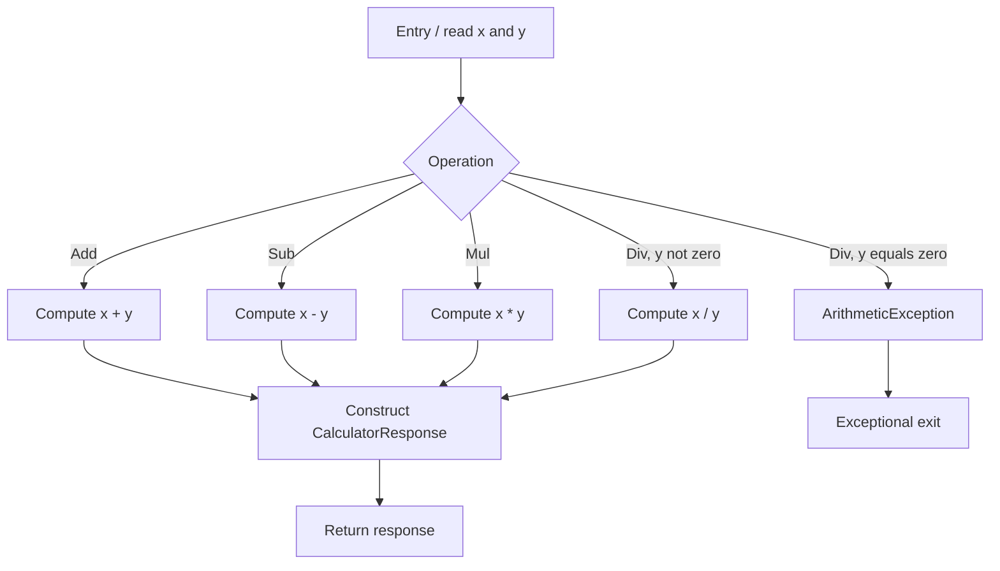

# CFG and Data-Flow (DU) Analysis

## Control-flow graph (CFG)

The calculator methods are intentionally simple. Each arithmetic endpoint has one entry, one straight-line computation, one `CalculatorResponse` construction, and one exit. There are no explicit `if`, `switch`, or loop statements, so the normal control-flow path for each arithmetic method is linear. `Div` also has an exceptional path when its second operand is zero because Java integer division throws `ArithmeticException`. `ping` returns a greeting plus a timestamp.

### Path-based tests

- **Add normal path:** `Add(8, 26)` returns 34.
- **Sub normal path:** `Sub(12, 8)` returns 4.
- **Mul normal path:** `Mul(11, 8)` returns 88.
- **Div normal path:** `Div(20, 5)` returns 4.
- **Div exceptional path:** `Div(10, 0)` throws `ArithmeticException`.
- **Ping path:** returns a string containing the stable greeting.

Since these methods contain no explicit conditional branches, JaCoCo may report branch coverage as N/A or zero for the calculator service. That does not mean exceptional behavior is irrelevant; an exception-path assertion checks behavior that a simple line-coverage percentage may not communicate well.

## Data-flow (DU) analysis

`CalculatorResponse(int x, int y, int result)` defines the instance fields `_x`, `_y`, `_result`, and `_time`. The getters use those definitions. The JUnit 5 response tests construct an object and then read each field through its getter, covering the principal definition-use (DU) pairs.

| Definition | Use | Test evidence |
|---|---|---|
| constructor parameter `x` assigned to `_x` | `getX()` | `constructorValuesReachAccessors` |
| constructor parameter `y` assigned to `_y` | `getY()` | `constructorValuesReachAccessors` |
| result assigned to `_result` | `getResult()` | `constructorValuesReachAccessors` |
| date string assigned to `_time` | `getTime()` | `constructorDefinesReadableTimestamp` |

The arithmetic methods define a result value from their input operands and pass that value to the response constructor. Tests assert the returned result for normal, negative, zero, and boundary inputs.

## Scope and limitations

These tests exercise the service and response objects directly; they do not launch the web container or verify HTTP routing, JSON serialization, malformed query parameters, or browser behavior. Those are reasonable future integration-test targets.
